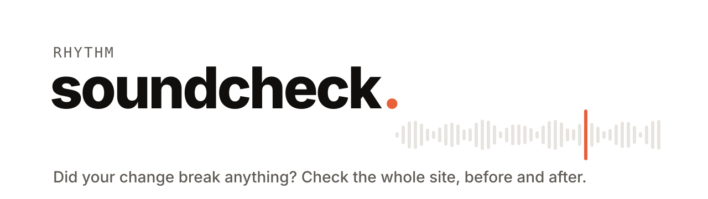
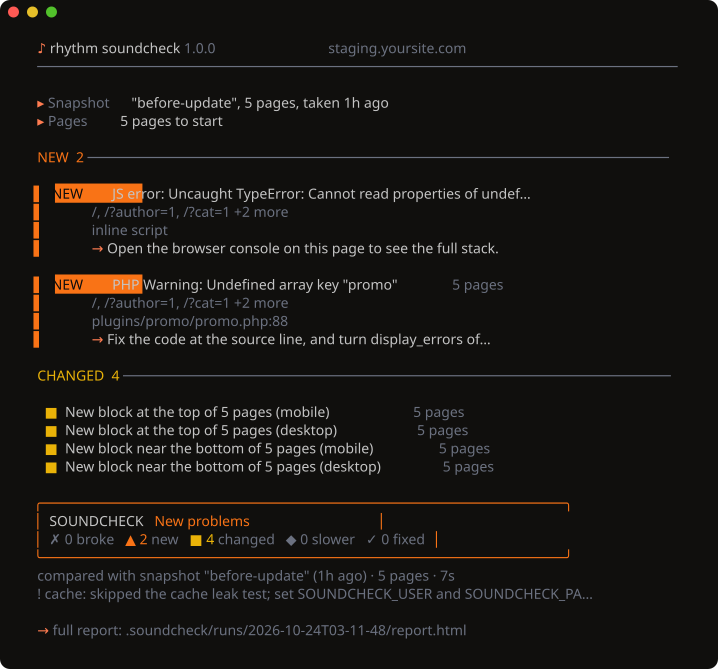

<p align="center">
  <picture>
    <source media="(prefers-color-scheme: dark)" srcset="docs/assets/banner-dark.svg">
    
  </picture>
</p>

<p align="center">
  <b>Did your change break anything?</b><br>
  Snapshot your whole site, update a plugin or deploy, then see exactly what broke: PHP errors, dead buttons, forms that stopped sending, leaking caches, layout shifts and slowdowns. Built for PHP &amp; WordPress, works on any site.
</p>

<p align="center">
  <a href="https://github.com/RhythmShahriar/soundcheck/releases/latest"></a>
  <a href="https://github.com/RhythmShahriar/soundcheck/actions/workflows/ci.yml"></a>
  <a href="LICENSE"></a>
  <a href="go.mod"></a>
</p>

<p align="center">
  <a href="#install">Install</a> ·
  <a href="#check-a-change">Check a change</a> ·
  <a href="#what-it-catches">What it catches</a> ·
  <a href="#accessibility-evidence-for-the-eaa">EAA</a> ·
  <a href="https://github.com/RhythmShahriar/rhythm/wiki/Soundcheck">Docs</a> ·
  <a href="https://github.com/RhythmShahriar/rhythm/wiki/Soundcheck-CI">CI</a> ·
  <a href="https://github.com/RhythmShahriar/rhythm/wiki/Soundcheck-Benchmark">Benchmark</a>
</p>

<br>

<p align="center">
  
</p>

<br>

## The Rhythm set

| | Asks | Checks |
|---|---|---|
| [Tuner](https://github.com/RhythmShahriar/tuner) | Is my site safe? | what an attacker can find |
| **Soundcheck** | **Did my change break anything?** | **what visitors see and do** |
| [Echo](https://github.com/RhythmShahriar/echo) | Is my site still saying what it should? | everything the site sends |

## Install

**macOS · Linux**

```sh
curl -fsSL https://rythm.sh/install | sh
```

**Windows** (PowerShell)

```powershell
irm https://rythm.sh/install.ps1 | iex
```

**Go**

```sh
go install github.com/RhythmShahriar/soundcheck/cmd/rhythm-soundcheck@latest
```

`rhythm-soundcheck` works on its own; `rhythm soundcheck` is the same tool through the rhythm CLI. `rhythm-soundcheck --version` prints the version you have; `rhythm-soundcheck --help` lists every command and flag.

Soundcheck drives a real browser. It uses Chrome or Chromium if you have one. Otherwise it downloads Chrome for Testing once, on first use, into your cache folder. The download is checked against the SHA-256 pinned in the binary. `--browser firefox` or `--browser webkit` captures pages in those engines instead. The installers check every download against the release checksums, which are [signed with cosign](https://github.com/RhythmShahriar/rhythm/wiki/Verifying-Releases).

## Check a change

No site handy? `rhythm-soundcheck demo` serves a small built-in site, snapshots it, breaks it and shows the comparison, in a few seconds and without touching your project folder.

```sh
rhythm-soundcheck snapshot staging.yoursite.com   # before: record how every page works
# …update plugins, switch PHP, deploy…
rhythm-soundcheck compare --open                  # after: what changed, in a report
```

Soundcheck finds your pages from the sitemap and links, opens each one in headless Chrome at desktop and mobile size, clicks what can be clicked, measures, takes screenshots and stores it all in `./.soundcheck`. `compare` checks the same pages again with the snapshot's modules, levels, viewports and browser unless you set others. It shows **only what's different**, most serious first:

| Class | Means |
|---|---|
| **BROKE** | worked in the snapshot, fails now: a 500, a fatal error, a form that no longer sends |
| **NEW** | a problem that wasn't there before: a PHP warning, a JS error, a dead button |
| **CHANGED** | looks or reads differently: layout, title, lost content |
| **SLOWER** | measurably slower, past a noise floor |
| **FIXED** | a problem from the snapshot is gone |

Add `--echo` (with [Echo](https://github.com/RhythmShahriar/echo) running) and each form submit and flow also records the emails, SMS and webhooks it sent, so "Form says sent but no message went out" is caught too. See [Soundcheck with Echo](https://github.com/RhythmShahriar/rhythm/wiki/Echo-With-Soundcheck).

| You want to… | Run |
|---|---|
| Compare staging with production right now | `rhythm-soundcheck staging.site.com --against site.com` |
| Check a site once, no snapshot | `rhythm-soundcheck run site.test` |
| A fast pass: desktop only, health and interactions | `rhythm-soundcheck run site.test --quick` |
| Test that forms still send (staging only) | `rhythm-soundcheck snapshot staging.site.com --level submit` |
| Catch a cache serving logged-in pages to visitors | `SOUNDCHECK_USER=test SOUNDCHECK_PASSWORD=… rhythm-soundcheck snapshot …` |
| A report for the pull request | `rhythm-soundcheck compare --md -o soundcheck.md` |
| Every report format from one run | `rhythm-soundcheck compare -o r.json -o r.md -o r.xml -o r.html` |
| Fail CI when something broke | `rhythm-soundcheck compare --fail-on broke` |
| Move over from BackstopJS | `rhythm-soundcheck import backstop.json` |
| Move over from Lost Pixel (page paths only) | `rhythm-soundcheck import lostpixel.config.ts --pages-only` |
| Accept a change you meant to make | `rhythm-soundcheck accept 3f2a9c01` |
| Go through the changes one by one | `rhythm-soundcheck review` |
| Accessibility evidence for the European Accessibility Act | `rhythm-soundcheck snapshot staging.site.com --eaa` |
| Also check what search engines see | `rhythm-soundcheck compare --modules +seo` |
| Carry on with a big snapshot that stopped | `rhythm-soundcheck snapshot shop.test --name before --resume` |
| Check many client sites in one go | `rhythm-soundcheck fleet sites.yaml compare` |
| Update WordPress plugins and find the one that breaks | `rhythm-soundcheck wp-update staging.site.com --wp "wp --path=/srv/www" --bisect` |

Every flag is in the [CLI reference](https://github.com/RhythmShahriar/rhythm/wiki/Soundcheck-CLI-Reference).

### Accept, ignore and review

A change you meant to make (a new header, a renamed page) shows up until the snapshot knows it. Each change has an id, shown next to CHANGED lines and as `id` in `--json`:

```sh
rhythm-soundcheck accept 3f2a9c01                          # this change is the new normal
rhythm-soundcheck accept --page '/team/*' --check 'visual/*'  # every visual change on the team pages
rhythm-soundcheck review                                   # a: accept, i: ignore always, s: skip, q: quit
rhythm-soundcheck report --serve                           # the same, with buttons in the HTML report
```

Changes that are known and shouldn't count go under `ignore:` in `.soundcheck/config.yaml`. They are listed as ignored and never fail a build. A rule with `until` stops applying after that day:

```yaml
ignore:
  - check: visual/page
    pages: ["/team/*"]
    until: "2026-12-31"
    reason: photos change weekly
```

Before reporting BROKE or NEW, `compare` visits those pages again; a page whose change came back gets one more visit. A change that doesn't come back on each visit is UNSTABLE: it is shown, yet it doesn't fail `--fail-on`. What the site-wide tests find (page cache, links) keeps its class, since a visit doesn't repeat them. `--confirm=off` skips these visits.

### More checks

- `--modules +a11y` runs axe-core's WCAG 2.1 A and AA rules on every page (`--wcag 2.2` for the 2.2 rules); `--eaa` adds the keyboard walkthrough and a statement draft, see [below](#accessibility-evidence-for-the-eaa); `+seo` compares canonical links, meta descriptions, robots rules, headings, hreflang, structured data, robots.txt and the sitemap. Both are off by default.
- Your own error signatures go in `.soundcheck/rules/*.yaml`, each with a `<name>_test.yaml` of positive and negative samples. `rhythm-soundcheck rules list` shows every rule; `rhythm-soundcheck rules test` runs the samples.
- Programs in any language can check every page: list them under `exec:` in the config and pass `--allow-exec`. Each gets the page as JSON on stdin and answers with issues on stdout. `rhythm-soundcheck --list-checks` lists every check.

### For agencies

- `rhythm-soundcheck fleet sites.yaml snapshot|compare` checks every site in the file, a few at a time. It ranks them worst first in `.soundcheck-fleet/fleet.html`.
- `rhythm-soundcheck report --client --brand agency.yaml -o client.html` writes a plain-language report with your name, logo and color, for a client. `agency.yaml` takes `name` (required), `logo` (a PNG, JPEG or SVG file in the same folder), `accent` (a hex color such as `"#0F766E"`; `color` works too) and `contact`.
- `rhythm-soundcheck history` lists every snapshot, run and comparison with the site's LCP trend; the HTML report draws it too. `--metric a11y` or `keyboard` shows the open accessibility or keyboard problems instead, `--page <path>` one page's figures and `--json` the series as JSON.
- `rhythm-soundcheck wp-update <url> --wp "<wp-cli command>"` updates plugins with WP-CLI, compares after each (or halves the suspects with `--bisect`), names the plugin that broke the site and can roll it back with `--rollback`. It never runs on a site listed as production.

`rhythm-soundcheck help <command>` explains each one.

> [!IMPORTANT]
> Check only sites you own or have permission to test. Soundcheck browses like a visitor at 5 page loads a second. It only submits forms when you turn the `submit` level on and refuses to on sites you list as production. See [Responsible use](#responsible-use--disclaimer).

## Accessibility evidence for the EAA

The European Accessibility Act asks shops and services to be usable without a mouse and to publish an accessibility statement. `--eaa` gathers the evidence for that review:

```sh
rhythm soundcheck snapshot staging.yoursite.com --eaa   # once: what the site does today
rhythm soundcheck compare --eaa --fail-on new           # after a change: new problems only
```

`rhythm soundcheck snapshot <url> --eaa` is the first command. The same mode works on `compare`, `run`, `--against` and `fleet`. The rest of this section uses `rhythm-soundcheck`; `rhythm soundcheck` runs the same commands through the router.

**What it checks.** On every page it visits, in Chrome:

- axe-core's WCAG 2.1 A and AA rules (`--wcag 2.2` for 2.2), plus placeholder-only labels, reflow at narrow width and overlay widgets.
- A real keyboard walk: Tab and Shift+Tab through the page, then menus, dialogs and disclosures. It reports keyboard traps, focus lost after a dialog closes, focus you can't see, skip links that go nowhere and controls only a mouse can use.
- Key flows: a flow marked `keyboard: true` is replayed with keys only, so "checkout can be finished by keyboard" becomes a test (`rhythm-soundcheck flows init --keyboard` writes four to edit).

Each finding is a normal issue keyed by rule and element, with its WCAG success criterion and EN 301 549 clause. NEW, FIXED, UNSTABLE, `accept`, `ignore:` and `--fail-on` work on it as on any other change: a new trap is BROKE, so the default `--fail-on broke` already stops it.

**What it never does.** It never gives a verdict on a site and never picks the statement's status for you. During the walk it holds requests that would send data and follows no links except skip links. A key flow only really submits with `keyboard: send` on a staging or local address. A page whose audit timed out is never reported as fixed: the run exits 3, since the evidence is incomplete.

**The statement.** Every `--eaa` run writes `eaa/statement-draft.md` in its folder. `rhythm-soundcheck init --eaa` adds a `statement:` block (owner, public address, contact) to `.soundcheck/config.yaml`; then

```sh
rhythm-soundcheck statement -o accessibility-statement.md   # also .html, .json, .jsonld (EARL for WCAG-EM)
```

drafts a statement in the layout of the EU model statement, with a table of every WCAG 2.1 A and AA success criterion: failures found, no failures found by these tests, or not tested: needs a person. Every place only you can fill in is marked `[TO DO]`.

**The evidence pack.** Each run also writes `eaa/evidence.json`: the SHA-256 of every file it recorded, the tool, Chrome and axe-core versions and a hash chain to the previous `--eaa` run of the same site. When `accept` changes a snapshot, or a snapshot is taken again or deleted, its pack is kept in `.soundcheck/evidence/` first, so the chain of later runs still verifies.

```sh
rhythm-soundcheck evidence verify                      # the files and the chain are unchanged
rhythm-soundcheck evidence verify --pub <key>          # and it was signed with this public key
rhythm-soundcheck evidence keygen -o soundcheck.key    # once
rhythm-soundcheck evidence sign --key soundcheck.key   # sign the latest pack
```

**In CI.** The [GitHub Action](#ci) takes `eaa`, `statement` and `wcag` inputs and gives `a11y-open`, `criteria-failed` and `incomplete` outputs:

```yaml
- uses: RhythmShahriar/soundcheck@v1.3.0
  with:
    url: ${{ github.event.deployment_status.target_url }}
    mode: compare
    baseline: main
    eaa: true
    comment: true
    fail-on: new        # fail on any new accessibility problem, not only traps
```

The job summary and the pull request comment carry counts and rule ids only. The full report is a workflow artifact kept for 14 days.

**Honest limits.** Automated and keyboard tests find some accessibility problems, not all. This is evidence for your own review, not a statement that the site meets WCAG, EN 301 549 or the European Accessibility Act.

1. Soundcheck's EAA mode gives you evidence about your site. It is not an audit, not a certification and not legal advice.
2. Many success criteria need a person: meaningful alt text, captions, reading order, plain language. The draft marks them not tested: needs a person, never passed.
3. Only the pages and flows Soundcheck visited, in the states it saw, in Chrome, with the keyboard walk at desktop width. Content in iframes from other sites, PDFs, videos, apps and emails was not tested.
4. The keyboard walkthrough uses Chrome's keyboard events. It is not a screen reader test, not a voice control test and not a test with disabled users.
5. The site decides what Soundcheck sees. A site that serves headless browsers a different page can pass while visitors fail. Overlay widgets don't make a site accessible.
6. EAA mode presses keys on your pages. It holds requests that would change data, blocks downloads and follows no links except skip links. A site that changes data on a GET or on focus can still change. Run it on staging and list your live site under production.
7. Reports contain what your pages showed. Soundcheck masks form values, credentials and tokens it recognises and emails, phone numbers and card numbers in text it writes. Masking is pattern-based: it is pseudonymised, not anonymised. Screenshots are not masked.
8. A signed evidence pack proves who produced it and that it wasn't changed afterwards. It doesn't prove the site was in that state for every visitor.
9. Nothing leaves your machine except requests to your own site and hosts you allow. No telemetry, no hosted service, no AI.

The [benchmark's EAA section](docs/benchmark.md#eaa-mode) measures what the checks catch on known cases and what they cost per page. More in `rhythm-soundcheck help eaa`.

## What it catches

<table>
<tr>
<td width="50%" valign="top">

### 🩺 Page health
PHP fatals, warnings, notices and deprecations with **file and line**, the WordPress "critical error" screen, white screens, JavaScript errors, failed XHR, REST and `admin-ajax` calls, broken links and assets, mixed content, lost titles and a new `noindex`.

</td>
<td width="50%" valign="top">

### 🖱️ Interactions
Menus, tabs, accordions and modals that stopped responding (**dead clicks**), clicks that throw and forms that lost their nonce, labels or action. Opt in to submit forms with test data: Contact Form 7, WPForms, Gravity Forms, Elementor and WooCommerce, plus your own YAML flows.

</td>
</tr>
<tr>
<td valign="top">

### 🖼️ Visual
Desktop and mobile screenshots of every page, diffed pixel by pixel with anti-aliasing tolerance. Sliders, ads and clocks are learned and ignored. A header change on 300 pages is **one** line, not 300.

</td>
<td valign="top">

### 🗄️ Cache correctness
Page cache hits and misses across Cloudflare, LiteSpeed, Varnish, nginx and WordPress plugins; carts and accounts served from cache; **logged-in content leaking to visitors**; cached pages carrying expired nonces; stale cache.

</td>
</tr>
<tr>
<td valign="top">

### ⚡ Speed
Lab LCP, CLS, TBT, TTFB, weight and requests, compared with noise floors so only real slowdowns show. Site-wide suggestions grouped by cause, including **what each plugin costs** every page. `--lighthouse` hands off to Unlighthouse.

</td>
<td valign="top">

### 📋 Reports
A live terminal view; a standalone HTML report with before/after sliders and filters; Markdown for pull requests; JUnit and JSON for CI; and a [GitHub Action](https://github.com/RhythmShahriar/rhythm/wiki/Soundcheck-CI).

</td>
</tr>
</table>

## Why Soundcheck

- **Answers one question.** Not a 400-line audit of everything imperfect: only what your change did, ranked.
- **The whole site, not five pages.** Pages are grouped by URL pattern: once a folder has more than 10 pages, the rest of `/product/{slug}/` is sampled 3 at a time, so a shop with 3,000 products is checked through 13 pages, not 3,000. A 100-page site takes about a minute and a half to snapshot and one to compare (8 tabs on a 16-core machine).
- **Knows WordPress.** PHP errors traced to the plugin file and line, plugin-aware speed costs, form plugin profiles, nonce and cache rules no generic tool checks.
- **Local and free.** One binary, your machine or your CI. No account, no cloud, no page limits. Snapshots stay in your project.
- **Safe on real sites.** Polite rate limits, a destructive-click blocklist, form submits off by default and refused on production, credentials only from environment variables, typed only on the site being checked and never written to reports.

How it compares with other tools is measured, not claimed: see the [benchmark](https://github.com/RhythmShahriar/rhythm/wiki/Soundcheck-Benchmark) of 20 deliberately broken sites.

## CI

```yaml
- uses: RhythmShahriar/soundcheck@v1
  with:
    url: https://staging.yoursite.com
    against: https://yoursite.com
    fail-on: broke
```

The Markdown report goes in the job summary. The HTML report and a JUnit file are attached as the `soundcheck-report` artifact (`soundcheck-report-2` and so on when a job uses the Action more than once). More in the [CI guide](https://github.com/RhythmShahriar/rhythm/wiki/Soundcheck-CI).

Containers may share one `.soundcheck` folder (a mounted volume) as long as each has a hostname of its own, which is Docker's default: Soundcheck tells their runs apart by hostname, since every container's run is often PID 1.

## Docs

| | |
|---|---|
| [Your first check](https://github.com/RhythmShahriar/rhythm/wiki/Soundcheck-First-Check) | snapshot, change, compare, in ten minutes |
| [Reading results](https://github.com/RhythmShahriar/rhythm/wiki/Soundcheck-Reading-Results) | the five classes, grouping, the HTML report |
| [Interactions](https://github.com/RhythmShahriar/rhythm/wiki/Soundcheck-Interactions) | levels, dead clicks and safety rules |
| [Forms and flows](https://github.com/RhythmShahriar/rhythm/wiki/Soundcheck-Forms-And-Flows) | form profiles, test data, YAML flows, logging in |
| [Cache](https://github.com/RhythmShahriar/rhythm/wiki/Soundcheck-Cache) | hits, private pages, leaks, nonces |
| [Configuration](https://github.com/RhythmShahriar/rhythm/wiki/Soundcheck-Configuration) | `.soundcheck/config.yaml` |
| [CLI reference](https://github.com/RhythmShahriar/rhythm/wiki/Soundcheck-CLI-Reference) | every command, flag, exit code and file |

All of it lives in the **[Rhythm documentation wiki](https://github.com/RhythmShahriar/rhythm/wiki)**.

## Contributing

```sh
git clone https://github.com/RhythmShahriar/soundcheck && cd soundcheck
make hooks   # Conventional Commits check
make check   # lint + tests (browser tests need Chrome or Chromium)
make test-short # the quick pass: tests that honour -short skip slow browser work
make testbed # 20 broken sites in Docker, for end-to-end tests and the benchmark
```

See [CONTRIBUTING](https://github.com/RhythmShahriar/.github/blob/master/CONTRIBUTING.md) for the Rhythm-wide rules. Writing a check module? [CONTRIBUTING.md](CONTRIBUTING.md) in this repository covers how a module plugs into a run.

## Responsible use & disclaimer

Soundcheck is built to help people **check their own websites** before and after changes.

- **Use it only on sites you own, or have explicit permission to test.** Automated browsing (especially submitting forms) on systems you aren't authorized to test may be illegal or break their terms of service.
- **You are responsible for how you use it.** The authors and contributors are not responsible for misuse, or for any damage, data, messages or orders created by tests you run, or any other loss arising from its use.
- **Test data is real data.** With the `submit` level on, forms really send: messages arrive, sign-ups are created. Use it on staging, route mail to a catcher such as Mailpit and list your live site under `production` in the config.
- **No warranty.** Soundcheck is provided "as is", without warranty of any kind, as set out in the [license](LICENSE). Lab measurements and screenshots vary; verify before acting.

Found a vulnerability in Soundcheck itself? Please [report it privately](https://github.com/RhythmShahriar/soundcheck/security/advisories/new).

## License

[MIT](LICENSE).

### Third-party

The binary embeds [axe-core](https://github.com/dequelabs/axe-core) 4.14.0 by Deque Systems for the `a11y` module, unmodified. axe-core is under the [Mozilla Public License 2.0](checks/a11y/vendor/LICENSE); its source is at [github.com/dequelabs/axe-core](https://github.com/dequelabs/axe-core) and in this repository at [checks/a11y/vendor/axe.min.js](checks/a11y/vendor/axe.min.js). The libraries it bundles are listed in [LICENSE-3RD-PARTY.txt](checks/a11y/vendor/LICENSE-3RD-PARTY.txt). Release archives carry both files under `THIRD_PARTY/axe-core/`.

<p align="center"><sub>Part of <a href="https://github.com/RhythmShahriar/rhythm"><b>rhythm</b></a> · Useful ideas. Working systems.</sub></p>
